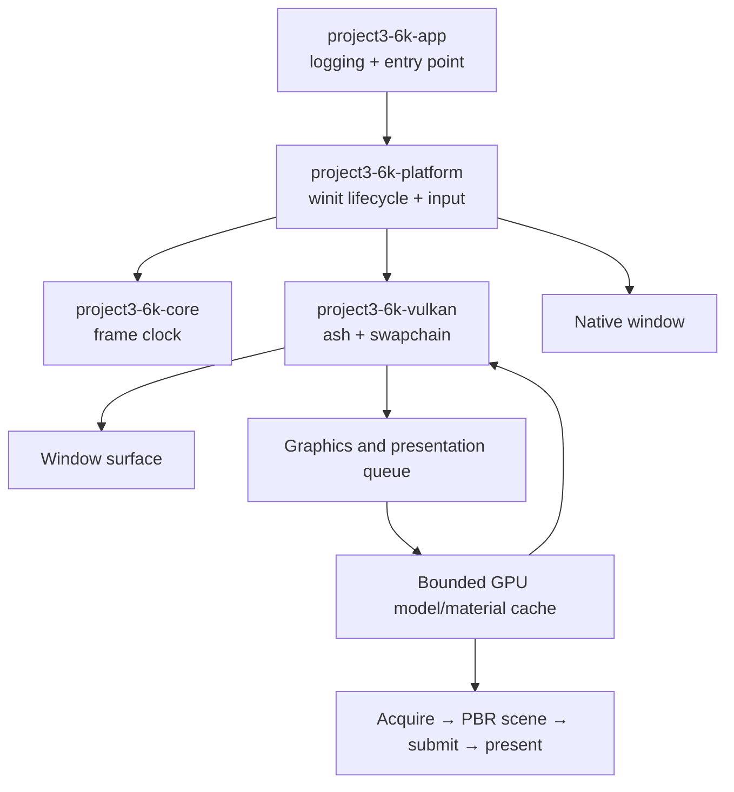

# Architecture

## Scope

The current phase extends the native Rust + Vulkan (`ash`) renderer with a bounded CPU asset pipeline and a progressively verified PBR rendering foundation. Gameplay, survival systems, terrain generation, and multiplayer remain outside this phase.

## Runtime flow

## Crate responsibilities and dependencies

- `project3-6k-core` contains reusable engine primitives without platform or graphics dependencies.
- `project3-6k-platform` owns the window, event loop, current keyboard state, frame pacing, and the renderer instance. It translates native events into engine-facing state.
- `project3-6k-assets` parses external models and textures into bounded CPU data and never creates Vulkan handles.
- `project3-6k-vulkan` owns Vulkan handles, GPU resource lifetime, render passes, and explicit acquire, command recording, submit, and present operations. It has no dependency on gameplay systems.
- `project3-6k-app` initializes logging and starts the platform application.

The dependency graph is one-way: app → platform → core and Vulkan. There are no circular crate dependencies. See [module-dependencies.md](docs/architecture/module-dependencies.md).

## Frame flow

1. The platform event loop receives window and keyboard events.
2. `about_to_wait` requests a redraw and waits until the next target frame interval.
3. The Vulkan renderer waits for the current frame fence and acquires a swapchain image.
4. It records the active scene with the GLSL graphics pipeline, submits work waiting on image acquisition, then presents after the image-specific render semaphore signals.
5. The scene uses a per-frame camera/sun uniform, role-correct texture descriptors, a GGX PBR shader, and cached device-local model buffers. Resize and out-of-date events wait for device idle and rebuild swapchain-owned resources.
6. `--run-frames N` exits after N successful queue submissions; `--auto-close` exits after Vulkan initialization. `--resize-stress` exercises size changes and minimized-window suspension. All use the same event-loop and RAII shutdown path as a window close.

## Error handling

Initialization and frame errors use typed `thiserror` enums and are logged at the application boundary. Vulkan failures are surfaced and terminate the app cleanly; they are not silently converted into a no-op. Debug builds require the Vulkan validation layer. The callback counts and logs every warning and error; the app returns a nonzero exit code if either count is nonzero.

The app logs `application shutdown complete` after dropping the renderer and then the native window. Validation messages are checked after that teardown so shutdown-time issues also fail the process. Automated frame counts include only successful queue submissions, not redraws skipped because the swapchain is suspended or out of date.

## Future networking

Gameplay state should remain separate from rendering and native input. Future networked simulation can put authority in a server-side simulation layer and expose validated commands/state snapshots, without making the renderer authoritative. No networking abstractions are added before there is a concrete simulation model.

## Current limits

The renderer now draws a technical scene with CC0 external glTF models and ground textures. The CPU asset crate imports bounded static glTF 2.0/GLB geometry, node transforms, raster images, and PBR maps. Vulkan owns a bounded GPU model cache, texture-role-correct mip chains, directional GGX PBR, normal mapping, and alpha-masked materials. The scene is still sparse and has no true FP16 HDR target, dedicated tone mapper, cast shadows, atmospheric fog, material blending, or streaming. Visual quality must be checked from rendered pixels, not compilation results. See [the renderer pipeline](docs/rendering/vulkan-pipeline.md) and [Decision 0015](docs/decisions/0015-vulkan-pbr-foundation.md).
