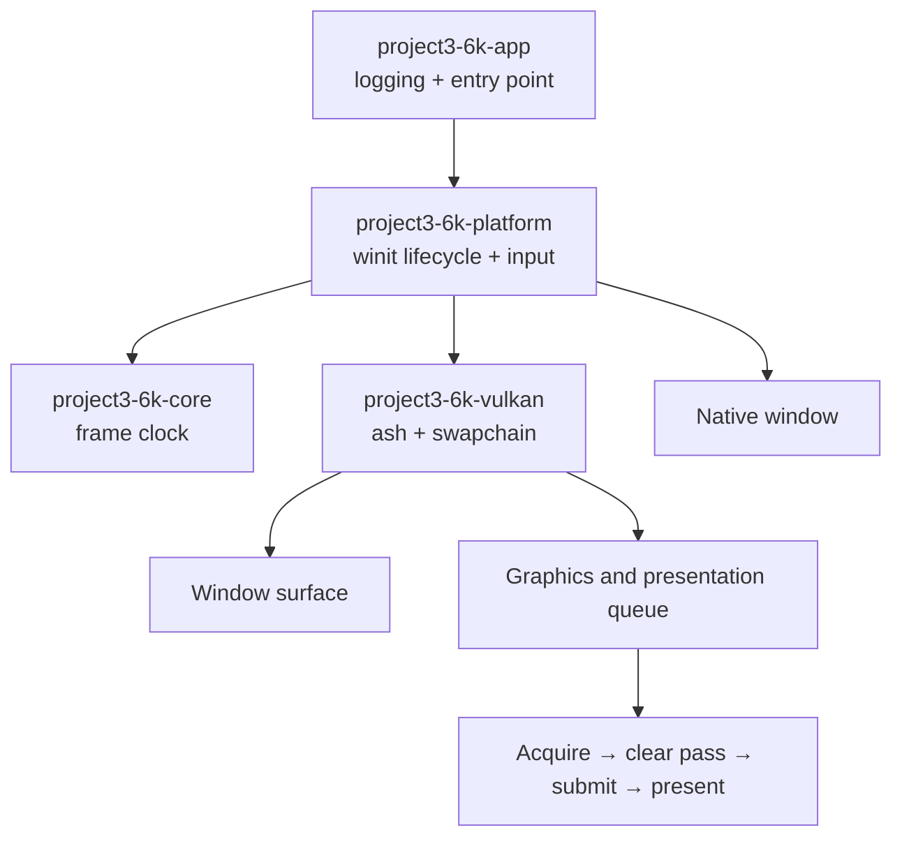

# Architecture

## Scope

The current phase establishes a native application loop and a safe Vulkan presentation path. Gameplay, entity systems, physics, audio, world generation, and advanced rendering stay out of the foundation until their engine interfaces are justified.

## Runtime flow

## Crate responsibilities and dependencies

- `project3-6k-core` contains reusable engine primitives without platform or graphics dependencies.
- `project3-6k-platform` owns the window, event loop, current keyboard state, frame pacing, and the renderer instance. It translates native events into engine-facing state.
- `project3-6k-vulkan` owns Vulkan handles and performs explicit acquire, command recording, submit, and present operations. It has no dependency on gameplay or scene types.
- `project3-6k-app` initializes logging and starts the platform application.

The dependency graph is one-way: app → platform → core and Vulkan. There are no circular crate dependencies. See [module-dependencies.md](docs/architecture/module-dependencies.md).

## Frame flow

1. The platform event loop receives window and keyboard events.
2. `about_to_wait` requests a redraw and waits until the next target frame interval.
3. The Vulkan renderer waits for the current frame fence and acquires a swapchain image.
4. It records a clear render pass for that image, submits work waiting on image acquisition, then presents after the image-specific render semaphore signals.
5. Resize and out-of-date events wait for device idle and rebuild swapchain-owned resources.
6. `--run-frames N` exits after N successful queue submissions; `--auto-close` exits after Vulkan initialization. Both use the same event-loop and RAII shutdown path as a window close.

## Error handling

Initialization and frame errors use typed `thiserror` enums and are logged at the application boundary. Vulkan failures are surfaced and terminate the app cleanly; they are not silently converted into a no-op. Validation warnings and errors use the `tracing` subscriber when the Vulkan validation layer is installed.

The app logs `application shutdown complete` after dropping the renderer and then the native window. Automated frame counts include only successful queue submissions, not redraws skipped because the swapchain is suspended or out of date.

## Future networking

Gameplay state should remain separate from rendering and native input. Future networked simulation can put authority in a server-side simulation layer and expose validated commands/state snapshots, without making the renderer authoritative. No networking abstractions are added before there is a concrete simulation model.

## Current limits

The first renderer submits a clear-only frame. It has no shader or pipeline manager, GPU allocator, depth buffer, texture path, scene graph, or profiling overlay. The selected Vulkan API level is 1.0; optional modern rendering features can be evaluated when a real pipeline is introduced.
