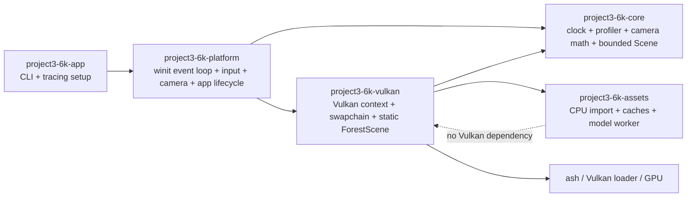

# Phase 0 — Foundation Audit

- **Audit date:** 2026-11-12
- **Repository:** `D:\Gametest\Project3.6k`
- **Branch / commit:** `codex/rendering-asset-foundation` / `d3b21b628bb4714a70fd75ae9f77b5633ceba810`
- **Scope:** inspect the committed Rust + Vulkan foundation, its build and runtime evidence, and its readiness for the phase-based open-world engine roadmap. No engine or gameplay code was added in this audit.

## Executive finding

The repository is a working Vulkan reference application with useful CPU/GPU asset and rendering foundations. It is **not yet an engine architecture for an open-world game**. The live application is a static renderer scene, application lifecycle, input, timing, and Vulkan rendering are composed directly in the platform crate, and the core `Scene` is not connected to the rendered scene. The next work should remain architecture and lifecycle work until the intended boundaries are reviewed.

Phase 0 evidence is sufficient to begin Phase 1. Phase 0 does not authorize jumping directly to ECS, world streaming, gameplay, or further visual features.

## Current architecture



The dotted relationship is a data handoff: the assets crate returns CPU-side types; Vulkan owns GPU allocations and their lifetime.

## Crate and module audit

| Crate | Implemented responsibility | State / boundary finding |
|---|---|---|
| `project3-6k-app` | CLI parsing, tracing subscriber setup, executable entry point | Implemented; thin binary. No configuration-file system. |
| `project3-6k-platform` | `winit::ApplicationHandler`, native window, input state, camera movement, frame timing, redraw pacing, resize stress, direct `VulkanRenderer` ownership | Implemented application shell. It is also the composition root and directly depends on Vulkan; it is not yet a backend-neutral platform layer. |
| `project3-6k-core` | `FrameClock`, fixed-capacity rolling profiler, camera math, `Transform`, bounded `SceneNode` vector and `MeshHandle` | Implemented primitives/prototype. `Scene` is not consumed by `ForestScene`; no ECS, event bus, transform hierarchy, world, scheduler, or spatial index exists. |
| `project3-6k-assets` | bounded static glTF/GLB import via `gltf` 1.4.1; bounded raster/HDR decoding; PBR CPU data; CPU model cache; PNG texture cache; bounded one-worker async model loader | Import and data types are implemented. `ModelAssetCache` and PNG `AssetManager` have unit coverage but are not wired into the live renderer's asset flow. No general asset registry, hot reload, audio import, or streaming. |
| `project3-6k-vulkan` | `ash` 0.38 context/device/surface; swapchain and frame synchronization; static ForestScene; bounded GPU model cache; RAII buffers/images; PBR, HDR, ACES, normal maps, one directional shadow map, environment lighting, capture | Implemented renderer foundation. Scene composition, asset IDs/paths, and transforms are hardcoded in `forest_scene.rs`; it does not render a World/ECS snapshot. |

Workspace uses Rust edition 2024, declared MSRV 1.85, and five crates. Direct workspace dependencies include `ash`/`ash-window`, `gltf`, `image`, `glam`, `winit`, `thiserror`, and `tracing`. The graph has no dependency cycles. The `project3-6k-assets` crate does not depend on Vulkan.

### Source-module inventory

| Crate modules | Actual role / audit result |
|---|---|
| app: `main.rs` | CLI validation, tracing setup, top-level error/exit handling; no engine object yet. |
| platform: `application.rs`, `input.rs`, `lib.rs` | `winit` lifecycle, input state, camera, frame timing, profiling, resize stress, renderer creation; the platform layer is also the current application composition root. |
| core: `camera.rs`, `profiler.rs`, `scene.rs`, `lib.rs` | Camera math, rolling profiler, value transforms and bounded scene nodes; scene data is not connected to Vulkan. |
| assets: `async_loader.rs`, `environment.rs`, `gltf_importer.rs`, `model_cache.rs`, `texture.rs`, `lib.rs` | Bounded CPU model/image/HDR import, PBR CPU data, CPU caches, mip processing, and one CPU worker. CPU caches are not used by `ForestScene`. |
| Vulkan: `renderer.rs` | Vulkan context/device/surface, swapchain lifecycle, frame acquire/submit/present, resize and validation boundary. |
| Vulkan: `forest_scene.rs`, `forest_mesh.rs` | Hardcoded technical scene, model placements/material descriptors/pipelines, ground plane geometry. |
| Vulkan: `gpu_asset_cache.rs`, `gpu_resources.rs` | GPU model/material cache, generation handles, upload, RAII buffers/images/samplers and staging. |
| Vulkan: `depth_buffer.rs`, `hdr_target.rs`, `shadow_target.rs`, `tone_map.rs` | Depth/HDR/shadow attachments and separate presentation tone-map pass. |
| Vulkan: `validation.rs`, `lib.rs` | Thread-safe validation report/callback state and public renderer API/re-exports. |

## Implemented, prototype, and absent systems

### Implemented and exercised

- Window lifecycle, keyboard/raw mouse handling, focus-loss cleanup, redraw pacing, close handling, resize/minimize stress mode, typed top-level errors, and tracing logs.
- Monotonic frame clock, bounded frame profiler, camera movement/projection math, and unit-tested value transforms.
- Bounded local glTF 2.0/GLB static-mesh/material import with external-path validation, image decoding, PBR map data, generation-checked cache handles, and a bounded CPU import worker.
- GPU model/material cache with byte/count limits, generation-checked handles, Vulkan RAII allocations, explicit frame fences, and validation monitor.
- FP16 HDR scene rendering, ACES tone mapping, sky/environment lighting, diffuse SH, GGX-prefiltered specular IBL + BRDF LUT, normal mapping, directional sun, one 1024² shadow map, alpha-masked foliage, fog, and PNG swapchain readback.

### Prototype or disconnected from the live path

- `core::Scene` and its mesh handles are a bounded container, not an ECS or the source of renderer draw data.
- `AssetManager` currently decodes PNG and `ModelAssetCache` stores CPU models; the live `ForestScene` imports models with `AsyncModelLoader` and uploads them directly to `GpuAssetCache` instead of composing those CPU caches into one registry.
- The CPU model loader has a worker, but startup requests a fixed set of models, waits synchronously for every completion, then uploads the models on the renderer thread. Environment decode, GGX prefiltering, and upload are synchronous too.
- The current visual scene is a hardcoded technical scene with 5 imported models and 7 placements, plus one flat textured ground plane. It is not a world, terrain system, or content-driven scene.
- `cargo test` covers CPU logic and Vulkan helper/unit logic. Runtime capture proves a real frame was read back, but there is no automated image-content threshold or scene-comparison test.

### Not implemented

ECS/entity generations and component storage; event bus; fixed-timestep simulation loop; engine configuration/state/service lifecycle; transform hierarchy; scene/world manager; spatial partitioning; job system; asset registry and generic async texture/audio loading; fence-retired GPU unloading; render graph; GPU instancing; frustum culling; LOD; cascaded shadow maps; terrain/chunk generation and streaming; physics, animation, spatial audio, or gameplay systems.

## Ownership, lifetime, and performance findings

- `EngineApplication` owns both `Window` and `VulkanRenderer` and explicitly drops the renderer first, preserving the Vulkan surface/window lifetime.
- `VulkanContext` owns instance, surface, debug messenger, logical device, queue handles, and shared validation state. `SwapchainState` owns swapchain-dependent render targets, `ForestScene`, tone-map pass, command resources, semaphores, and fences. Vulkan allocations are wrapped in RAII types.
- CPU model data moves from the bounded loader completion channel to the renderer thread. The loader joins at drop. No worker creates or mutates Vulkan objects.
- GPU cache budget is 256 MiB; current log reported 138,377,796 bytes for model buffers/textures. Ground reported 16,777,212 bytes. Environment CPU data reported 45,700,448 bytes and its FP16 GPU payload 22,850,224 bytes. These are tracked subsystem payloads, not total process/GPU memory.
- Texture/model upload helpers wait for the graphics queue; swapchain teardown and scene recreation wait for device idle. A real resize can rebuild and re-upload the static scene. This is safe for the current startup-oriented demo but is a known stall and lifetime boundary for an engine.
- The single CPU worker and explicit budgets are sound foundations. There is no aggregate resident-world budget or cancellation/priority policy for future streaming.

## Build, tests, validation, and runtime evidence

Commands run at the audited commit:

```powershell
cargo fmt --all -- --check
cargo test --workspace
cargo clippy --workspace --all-targets -- -D warnings
cargo build --release -p project3-6k-app
```

All passed. Workspace tests: **49 passed, 0 failed** (app 7, assets 19, core 13, platform 2, Vulkan 8). Release app build completed in 5.11 seconds on this checkout with its existing build cache.

Runtime evidence on NVIDIA GeForce GTX 1660 SUPER:

- Release `--run-frames 5 --validation --capture-frame ...` exited 0. Vulkan validation reported **0 warnings and 0 errors**. A 1280×720 swapchain image was read back to [phase0-baseline.png](../../artifacts/visual-verification/phase0-baseline.png), opened, and visually checked.
- The app reached ready in approximately 1.68 seconds from native window creation in the capture run. Model CPU import was 241 ms, model GPU upload 673 ms, and environment decode/prefilter/upload 291 ms.
- Release `--run-frames 600` reached the frame limit and exited 0. Rolling 120-frame batches reported 71.5–78.3 FPS, average frame intervals 12.77–13.99 ms, p95 13.58–14.40 ms. One batch maximum was 66.1 ms; keyboard input arrived during the run, so this is an interactive desktop measurement and includes a scheduling/input disturbance. The application is capped near the display's 75 Hz path; this is not an uncapped GPU benchmark.

The screenshot confirms the renderer features are running, but also confirms the scene limitations: large flat ground, sparse foreground props, and a distant HDR panorama. No claim of a finished realistic forest is supported by this evidence.

## Technical debt, priority, and phase gates

| Priority | Finding | Why it matters | Phase to resolve |
|---|---|---|---|
| P0 | Existing architecture and ownership docs disagree with current source (for example, environment IBL is described as future work in `overview.md`; texture and scene ownership descriptions predate the current renderer). | Stale docs can cause the next phase to be designed against a false system. | Phase 0/1 |
| P1 | Runtime composition, camera, event handling, and Vulkan renderer are coupled in `project3-6k-platform`; core `Scene` is disconnected. | New world and simulation modules have no stable data boundary into rendering. | Phase 1/2/3 |
| P1 | CPU cache prototypes and GPU cache have no shared registry/handle lifecycle. | Duplicate loads, unload semantics, and stable ownership across CPU/GPU tiers are not yet one system. | Phase 1/4 |
| P1 | Asset import is asynchronous only for a fixed startup model set; completion is synchronously drained; GPU upload/resize rebuilds block. | Not suitable for large worlds or frequent asset changes. | Phase 4/6/10 |
| P1 | No ECS, world, hierarchy, spatial partition, or render snapshot exists. | Current hardcoded scene cannot scale into open-world content. | Phase 1/3/6 |
| P2 | Single 1024² shadow map, no culling/instancing/LOD/render graph. | Rendering features are a useful foundation but not production-scale. | Phase 5/10 |
| P2 | Automated visual verification captures a real frame but does not check pixels against scene invariants. | Driver/API validation cannot establish visual correctness. | Phase 5/10 |

## Worktree note

At audit time, the committed source is at `d3b21b6`. The worktree also contains the pre-existing untracked shortcut `crates/Project3.6k - Shortcut.lnk` and three untracked Poly Haven download directories (`fir_sapling`, `fern_02`, `moss_01`) left by an interrupted, uncommitted visual-scene experiment. They are not referenced by the audited source or included in the tests. A recursive cleanup command was blocked by the execution policy, so these files are left unmodified and must not be mistaken for committed assets.

## Phase 0 acceptance

- All five crates, their direct dependencies, actual module responsibilities, prototypes, and missing systems were inspected.
- Current dependency and ownership boundaries are documented above and expanded in [Master Architecture](master-architecture.md).
- Build, workspace tests, Clippy, runtime Vulkan validation, readback, and a bounded Release performance run were observed at the audited commit.
- The next design gate is Phase 1 review. No engine module, gameplay feature, or renderer rewrite is authorized by this audit.
