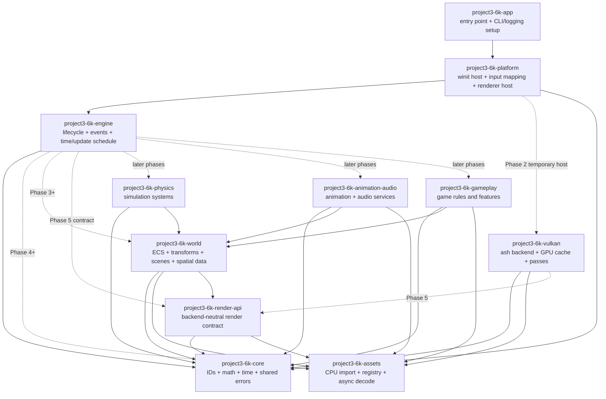
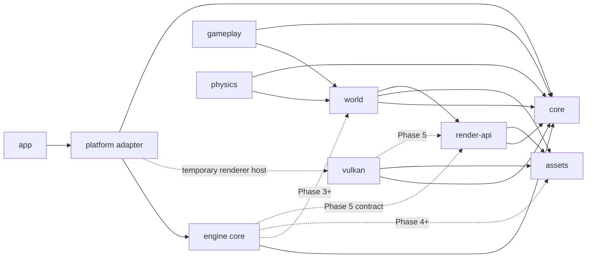
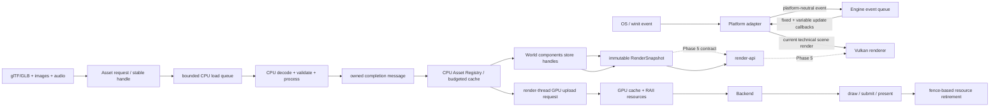
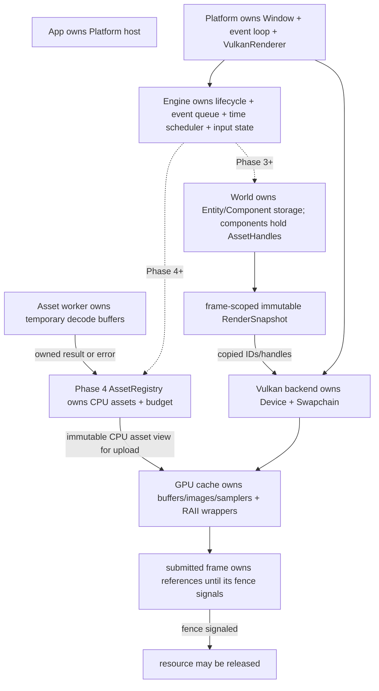
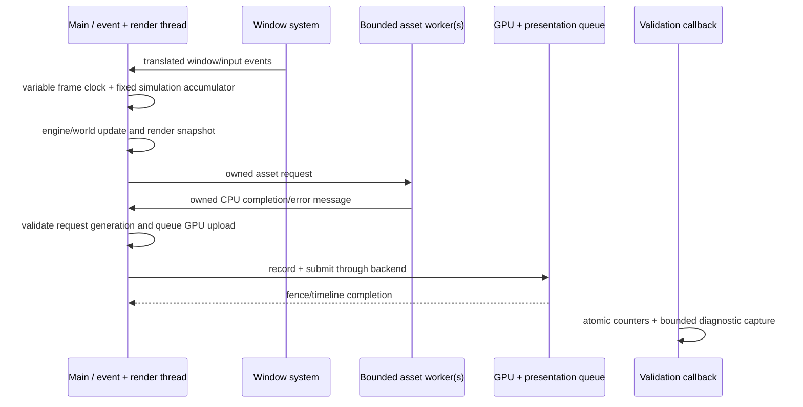

# Project3.6k — Master Engine Architecture

- **Status:** Phase 1 architecture reviewed; Phase 2 implementation is in progress.
- **Baseline:** source commit `d3b21b628bb4714a70fd75ae9f77b5633ceba810`, audited in [Phase 0](foundation-audit.md); boundary review in [Phase 1 Review](phase-1-architecture-review.md).
- **Rule:** proposed modules and boundaries below are not implemented until their phase starts and its acceptance criteria are agreed.

## 1. Architecture goals and constraints

Project3.6k is intended to support a realistic open-world game over multiple phases. The current repository is a functioning Rust + Vulkan foundation, not a reason to rewrite from scratch. The design keeps existing code where its responsibilities fit, adds interfaces only when a phase needs them, and separates world/game logic from Vulkan.

### Constraints

- Keep Rust, Cargo, `ash`, `winit`, and the current CPU-import / GPU-resource ownership split.
- Do not implement gameplay, terrain generation, ECS, or new rendering features during Phases 0–1.
- Keep `project3-6k-assets` free of Vulkan types and handles.
- Keep Vulkan resource creation, submission, synchronization, and destruction in the rendering backend.
- Keep the native event pump in the platform adapter. The engine core consumes platform-neutral events and provides lifecycle/time/update scheduling without depending on `winit`.
- Never put raw pointers, borrowed file buffers, or Vulkan handles in ECS components or cross-thread messages.
- Require evidence before introducing a new crate, job system, allocator, render graph, or abstraction layer.

## 2. Core architecture



`project3-6k-engine` is introduced in Phase 2 with only the concrete lifecycle/event/time boundary; world, render-api, and later simulation/gameplay crates remain proposed until their phases. The current Platform → Vulkan composition edge is temporary. Phase 5 may move backend selection behind a renderer contract once the World render snapshot is defined. World and gameplay never call `ash`.

### Module responsibilities

| Module | Owns | Must not own |
|---|---|---|
| App | executable arguments, tracing subscriber setup, process exit reporting | engine state, window loop details, Vulkan resources, world state |
| Engine | lifecycle state, bounded platform-neutral events, logical action input, time/fixed+variable update schedule, engine config/errors | `winit`, native window, camera policy, renderer selection, raw Vulkan resource lifetime |
| Platform | native event loop/window, OS-to-engine event translation, physical input mapping, camera controller, temporary Vulkan composition | ECS, world ownership, asset decoding, Vulkan internals beyond calling the renderer API |
| Core | entity/asset IDs where backend-neutral, math, time primitives, typed shared contracts | window, filesystem decoding, GPU handles, game-specific components |
| Assets | source metadata, CPU decoding/validation/processing, CPU cache, async load requests/completions | `ash`, `vk::*`, graphics queues, render-pass state |
| World | entity/component storage, transform hierarchy, scenes/worlds, spatial queries, asset references, render snapshot creation | Vulkan handles, file decoding, application event loop |
| Render API | backend-neutral render snapshot and renderer lifecycle contract | concrete GPU resources or gameplay systems |
| Vulkan backend | device/swapchain, GPU asset cache, uploads, render passes, shaders, fences, readback | entity ownership, world mutation, inventory/combat rules |
| Physics / Animation-Audio / Gameplay | their phase-specific simulation and rules | platform handles, direct Vulkan calls, asset file decoding |

The present `project3-6k-platform` combines the native event loop, input, camera, frame clock/profiling, and direct Vulkan construction. Phase 2 extracts lifecycle, event dispatch, input state, and update scheduling into `project3-6k-engine`; the existing `winit` loop remains the host adapter and drives that engine API. The Platform → Vulkan edge is a temporary composition boundary until a backend-neutral renderer contract is justified in Phase 5. This keeps Phase 2 implementable without making Engine depend on `winit` or inventing a renderer API early.

## 3. Module dependency rules

1. Dependencies point toward stable, lower-level contracts; no crate cycles.
2. `core` is a leaf and cannot depend on platform, assets, world, or Vulkan.
3. `assets` may depend on core IDs/math, but never on Vulkan or world.
4. `world` depends on core and asset handles. It publishes immutable render data rather than GPU objects.
5. `render-api` depends on core and asset handles only. The Vulkan backend implements it.
6. `project3-6k-engine` depends on `project3-6k-core` and small shared utility crates only. It must not depend on `winit`, `project3-6k-platform`, or `project3-6k-vulkan`.
7. The executable uses the platform host in Phase 2. Backend selection can move to app/engine only after Phase 5 defines a concrete backend-neutral contract. Gameplay depends on world/core/services and cannot depend on Vulkan.
8. Avoid a new crate when an internal module is enough; extraction requires two real consumers, a cycle-prevention need, or a material compile/API boundary.

During Phase 2, `project3-6k-platform` depends on `project3-6k-engine` to adapt OS events and drive engine ticks. This dependency direction is intentional and acyclic. The direct platform-to-Vulkan construction remains temporary; changing that edge requires a concrete renderer contract and belongs to Phase 5.

### Phase 2 dependency graph



This graph records the Phase 2 dependency direction and future edges without implying the future crates already exist. The platform-to-Vulkan edge is marked temporary. The actual graph is recorded separately in [module-dependencies.md](module-dependencies.md).

## 4. Data flow



Rules:

- Importers return validated, owned CPU data and structured errors. They do not upload to the GPU.
- The asset registry owns CPU-resident assets and source/license metadata. World components keep stable handles, never pointers into registry vectors.
- The engine receives completion messages and decides whether a result is still wanted. Failed or cancelled requests cannot mutate the world from a worker thread.
- The renderer resolves render handles to GPU cache entries and records commands. GPU resource creation stays on the renderer-owned thread/queue until an explicit upload-queue design is justified.
- The render snapshot is immutable for a submitted frame. A later mutable world update cannot invalidate memory consumed by the renderer.
- Streaming is chunked and budgeted; no full-world eager load is permitted.

## 5. Memory ownership and resource lifetime



### Lifetime rules

- `EntityId` and `AssetHandle` use index + generation (or monotonic UUID) so unloading/reusing a slot cannot validate a stale reference.
- CPU registry and GPU cache have separate count and byte budgets. The cache reports resident, pending-upload, and retired-but-in-flight bytes separately.
- Components own lightweight IDs/handles and values, not heap asset payloads or Vulkan handles.
- `Arc` may share immutable CPU payloads between registry, upload tasks, and import consumers; all shared ownership still contributes once to the registry budget. Avoid `Arc<Mutex<...>>` as the default mutable system architecture.
- GPU entries are released only after the last referencing submission fence/timeline value is complete. `device_wait_idle` is allowed for final shutdown and rare reconstruction, not ordinary unload/streaming.
- Temporary importer/staging allocations are scoped and dropped once ownership transfers. Every budget is checked before allocation where size can be derived.
- Resize should recreate swapchain-sized attachments but must not reload persistent CPU models or unrelated GPU assets.

## 6. Threading and scheduling model



| Thread | Responsibility | Ownership restrictions |
|---|---|---|
| Main/event thread | window events, platform-neutral event dispatch, engine fixed/variable update schedule, Vulkan recording/submission initially | sole writer of Engine state, live World when added, and Vulkan objects in the first implementation |
| CPU asset workers | file read, CPU decode, validation, mesh/texture processing | return owned messages only; never mutate World/registry or touch Vulkan |
| GPU/presentation execution | executes submitted command buffers asynchronously | synchronization and lifetime are expressed by backend fences/semaphores |
| Validation callback | driver diagnostics on implementation-selected thread | atomic summary and bounded owned messages; no renderer mutation |

Start with the current single bounded model worker. Add worker count or a job system only after profiling demonstrates CPU saturation and after cancellation, memory pressure, and deterministic shutdown are designed.

## 7. ECS, world, and transform model

- Use generation-safe `EntityId` values. Destroying an entity invalidates its prior ID.
- Store components in data-oriented dense/sparse storage, grouped by component type. Do not make each entity own a tree of `Box<dyn Component>`.
- Initial core components: `Transform`, `StaticMesh`, `MaterialOverride`, `Visibility`, and optional bounds. Gameplay-specific components live in later modules.
- `Transform` stores local translation/rotation/scale and optional parent ID; hierarchy changes validate cycles. World transforms are derived/cached with explicit dirty propagation.
- Systems declare read/write component access. Phase 3 may run them sequentially; schedule parallel work only after access conflicts and profiling are understood.
- `World` owns entities, component storage, scene membership, and local spatial queries. Phase 3 proves entity storage and query cost; Phase 6 adds chunk/region ownership and streaming.
- Render snapshots copy visible transforms and handles into frame-owned data. A destroyed entity after snapshot creation cannot invalidate an in-flight frame.
- `core::Scene` remains a prototype until Phase 3 maps its semantics to the ECS design; do not silently treat it as the final World API.

## 8. Rendering and CPU/GPU boundary

The current `project3-6k-vulkan` contains rendering API and backend code in one crate. Keep it intact until Phase 5 defines an input contract. Then extract only a small backend-neutral renderer contract if the engine needs to select backends without depending on Vulkan types.

CPU side: asset registry → material/mesh handles → World render snapshot. GPU side: backend resolves handles → GPU asset cache → pass resources → command submission. No `vk::*` type crosses into core, world, gameplay, or the CPU importer.

The renderer phase may introduce render-pass/graph scheduling, cascaded shadows, frustum culling, instancing, and LOD, but only after render input and ownership boundaries are accepted. The existing PBR/HDR/IBL/shadow foundation is retained, not rewritten.

## 9. Asset and resource architecture

- `AssetId` identifies a logical source; `AssetHandle<T>` is a generation-safe runtime reference; `AssetMetadata` records path/source, author, license, import settings, content hash, and dependency edges.
- CPU importer registry owns source dependencies and decoded immutable payloads. Model, texture, material, environment, and later audio assets have typed CPU representations.
- Texture channel meaning remains explicit: sRGB color/emissive versus linear normal/roughness/metallic/AO. glTF packed channels are interpreted by material binding, not inferred from a filename.
- A bounded queue moves `LoadRequest` to worker and `LoadCompletion` back. Requests carry IDs/generations; stale completions are discarded. Errors preserve asset path and stage (read/decode/validate/process/upload).
- Renderer GPU cache is a separate tier with its own byte budget and explicit upload/release operations. Repeated IDs resolve to the same live resource; unloading a CPU asset cannot invalidate a GPU resource still in use.
- Texture and model LOD, streaming, eviction priority, and async uploads are not prerequisites for the first registry; define them in Phase 6/10 when world budgets and actual demand are known.

## 10. Error propagation and recovery

- Each crate defines contextual typed errors with `thiserror`; lower layers return errors and do not log-and-continue silently.
- Engine startup failures are fatal with the failing subsystem named. A failed optional asset is reported with its source path and request ID; only explicit fallback policy can substitute content.
- Window zero extent is a suspended renderer state, not an error. Swapchain out-of-date/suboptimal results trigger controlled recreation.
- Validation warnings/errors are retained and make verification commands fail after orderly teardown.
- Shutdown is idempotent at the application boundary. Drop owns normal cleanup; explicit shutdown handles ordering when external handles (Window/Surface) require it.
- Retry policy belongs to Engine/AssetRegistry and is bounded. Import workers report errors; they do not retry in an unbounded loop.

## 11. Testing and acceptance model

| Test level | Evidence |
|---|---|
| Unit | IDs/generations, limits, import validation, transforms, time accumulator, component stores, error conversion, cache accounting |
| Integration | app lifecycle init/event/update/shutdown; glTF → CPU registry → renderer upload → unload; resize/minimize restore; resource shutdown under validation |
| GPU/runtime | fixed-frame execution, validation report, resource counters and fence retirement, resize stress, capture path |
| Visual | deterministic test camera/scene, saved baseline image, image-space checks for geometry/material/shadow regions, human inspection; a successful compile alone is not visual evidence |
| Performance/memory | Release measurements with GPU/driver/resolution/window settings, median/p95/max frame intervals, startup/stream timings, CPU/GPU resident and peak bytes |

Every phase defines its own acceptance gate below. Passing narrower unit tests does not imply the full phase is complete.

## 12. Directory structure

```text
crates/
  project3-6k-app/                 # current: binary and command-line parsing
  project3-6k-core/                # current: timing, math, camera, prototype Scene
  project3-6k-platform/            # current: winit event loop/input; later OS adapter only
  project3-6k-assets/              # current: CPU model/texture/HDR import and caches
  project3-6k-vulkan/              # current: Vulkan backend and static ForestScene
  project3-6k-engine/              # Phase 2: lifecycle, bounded events, input actions, time/update schedule
  project3-6k-world/               # proposed in Phase 3: ECS, World, spatial data
  project3-6k-render-api/          # proposed in Phase 5 only if a backend-neutral contract is needed
  project3-6k-physics/             # proposed in Phase 7
  project3-6k-animation-audio/     # proposed in Phase 8; split only if ownership warrants it
  project3-6k-gameplay/            # proposed in Phase 9
assets/
  reference_scene/                  # licensed technical-scene assets + provenance
  game/                             # proposed runtime content root, added with AssetRegistry
docs/
  architecture/                    # audit, master architecture, phase contracts
  decisions/                        # accepted technical decisions
  memory-management/                # current/target ownership rules
  threading/                        # current/target thread rules
  rendering/                       # Vulkan/render pipeline details
```

This is a target organization, not an instruction to create empty crates or move current files now. Directory layout follows accepted interfaces, never the other way around.

## 13. Development phase specifications

| Phase | Scope and outputs | Acceptance criteria / gate |
|---|---|---|
| 0 — Foundation Audit | Current crates/modules, dependencies, actual/prototype/missing systems, ownership, performance, build/tests/validation; audit report | Evidence linked to current source and runtime; current architecture diagram; findings and priorities. **Complete in `foundation-audit.md`.** |
| 1 — Master Architecture | Module responsibilities/dependencies, data flow, memory ownership, threading, ECS, render, assets, world, errors, tests, directory layout, phase contracts | All requested diagrams and boundaries written down; current-vs-target distinction explicit; no code implementation. **Review passed with a documented Phase 2 host-adapter correction; see [review](phase-1-architecture-review.md).** |
| 2 — Engine Core | Engine/application lifecycle state, bounded platform-neutral event queue, action input abstraction, fixed/variable update schedule, engine config/error state, lifecycle logs; reuse existing `FrameClock`, app tracing setup, and platform `winit` loop | Start → OS event translation → engine event/update → render → orderly shutdown integration test; deterministic time/lifecycle/event tests; zero Vulkan validation/lifetime errors; no leaks observed in repeated start/stop and resize runs. |
| 3 — Entity & World Architecture | Generation-safe entity IDs, component storage, systems, hierarchy transforms, Scene/World lifecycle, bounded spatial queries | Create/update/destroy and query at 100k-entity test scale; stale IDs rejected; memory and p50/p95 update/query timings recorded; no Vulkan dependency in World. |
| 4 — Asset & Resource Architecture | Unified registry/metadata, static glTF/GLB and texture/material CPU assets, bounded async jobs, stable handles, CPU/GPU tier cache and unload | Load external model/material, deduplicate repeated loads, enforce budgets, report import errors, unload/reload while invalidating stale handles, and release GPU objects only after safe retirement. |
| 5 — Rendering Architecture | Backend-neutral render snapshot, render pass/graph boundary, GPU ownership, PBR/HDR/shadows/IBL, culling, instancing, LOD integration | Renderer consumes snapshot/asset handles without gameplay types or Vulkan leakage; validation clean; pixel/runtime evidence for each rendering gate; frame and memory budgets measured. |
| 6 — World & Environment | Terrain/chunks, vegetation/foliage, wind, biome/environment, LOD and streaming | Move through multiple chunks; stream in/out within declared CPU/GPU budgets; unloaded content is reclaimed after GPU retirement; no full-world eager load. |
| 7 — Physics & Simulation | Collision, rigid bodies, raycasts, character controller | Deterministic or bounded-step simulation tests; contact/raycast correctness; stable memory/performance at agreed entity scale. |
| 8 — Animation & Audio | Skeletal animation/graphs and audio mixer/spatial audio | Import/playback tests, time-step independence, resource cleanup, and profiling on representative scene. |
| 9 — Gameplay Framework | Interaction, inventory, weapon/combat/survival/building systems as explicitly selected | Gameplay systems operate on World/services and never call Vulkan; feature acceptance tests at system level. |
| 10 — Optimization & Production | Profiling, parallelism, memory optimization, stability, packaging | Reproducible performance targets; stress/soak/resize/unload tests; clean package works without development-only asset paths; known issues recorded. |

## 14. Phase change control

- The active phase is named in each implementation task and has a written acceptance gate.
- Architecture changes update this document and the relevant module/ownership/threading diagrams in the same change.
- No implementation feature is added merely because it is visually attractive or easy to demonstrate; it must serve the active phase's acceptance criteria.
- If evidence requires changing a previous decision, record why and update the decision log before implementing the replacement.
- Phase completion is based on observed acceptance evidence, not on the amount of code written.
