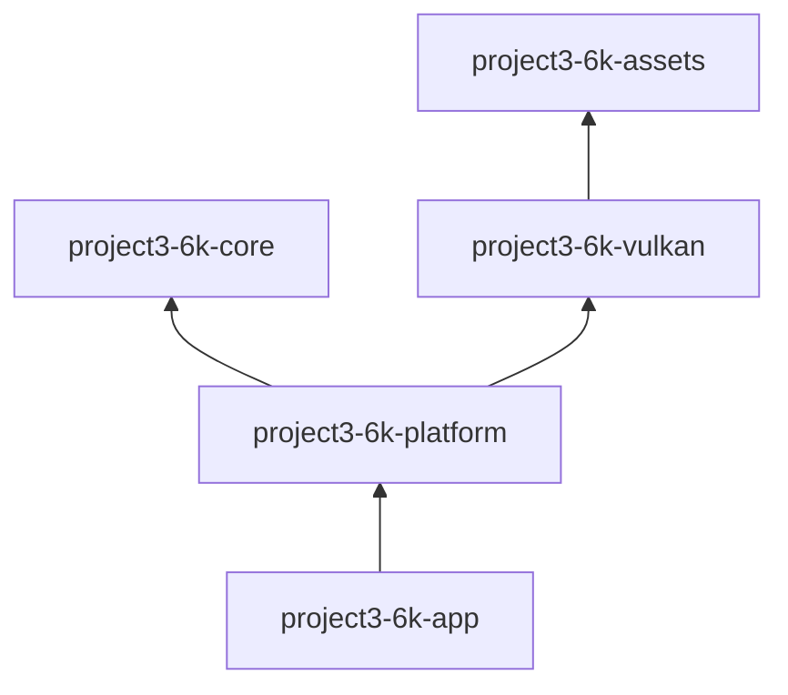

# Module dependencies

## Current crates

| Crate | Depends on | Public responsibility |
|---|---|---|
| `project3-6k-assets` | `png`, `thiserror` | Bounded PNG decoding, texture mip generation, and CPU asset cache |
| `project3-6k-core` | `glam`, `thiserror` | `FrameClock`, `FrameTime`, camera math, bounded scene nodes, and transforms |
| `project3-6k-vulkan` | `ash`, `ash-window`, `glam`, core, assets, `raw-window-handle`, `winit`, `thiserror`, `tracing` | `VulkanRenderer` initialization, transformed scene upload, color/depth attachments, texture upload, resize, and draw API |
| `project3-6k-platform` | core, Vulkan, `winit`, `thiserror`, `tracing` | `run()`, keyboard/mouse `InputState`, and window controls |
| `project3-6k-app` | platform, `tracing`, `tracing-subscriber` | executable entry point |

The platform crate coordinates core timing and Vulkan. Core does not know about windows, graphics, or application startup. Vulkan does not depend on input or game state. This prevents a cycle between engine subsystems.

## Crates intentionally deferred

There are no empty crates for scene, world, physics, audio, or debug UI. Assets now has a concrete CPU texture-loading and bounded-cache responsibility. Other crates should be added when their first concrete public interface is ready.
