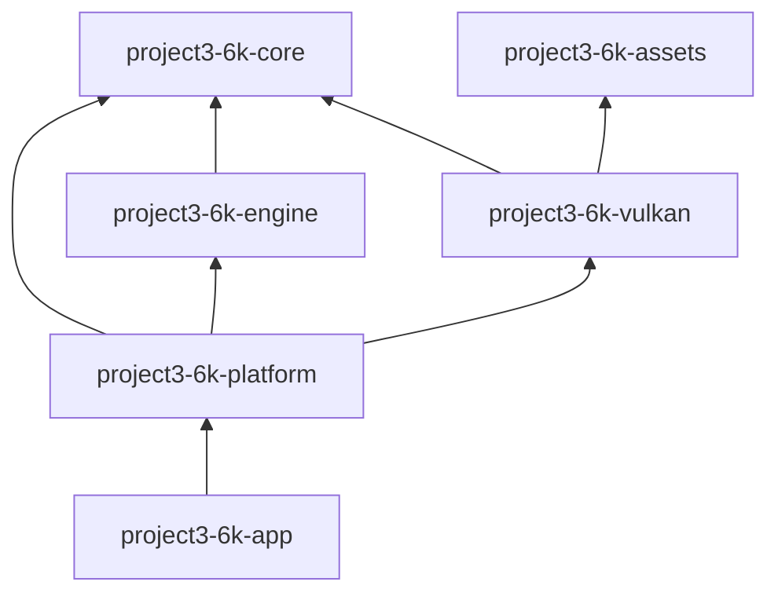

# Current module dependencies

This graph reflects the current Phase 2 implementation. The verified package graph is acyclic. The Phase 2 boundary review and the distinction from future target edges are in [Master Engine Architecture](master-architecture.md) and [Phase 1 Review](phase-1-architecture-review.md).

| Crate | Direct dependencies | Actual responsibility |
|---|---|---|
| `project3-6k-app` | platform, tracing, tracing-subscriber | Binary entry point, CLI parsing, tracing subscriber setup |
| `project3-6k-platform` | core, engine, Vulkan, thiserror, tracing, winit | `winit` host/event loop, native event translation, physical key mapping, camera controller, renderer composition |
| `project3-6k-engine` | core, thiserror, tracing | Engine lifecycle state, bounded event dispatch, logical input state, fixed/variable scheduling, engine config/errors |
| `project3-6k-core` | glam, thiserror | `FrameClock`, `FrameTime`, profiler, camera math, transform values, bounded Scene prototype |
| `project3-6k-assets` | base64, glam, gltf, image, png, thiserror | Bounded CPU image/model/environment import, PBR CPU data, CPU caches, async model loader |
| `project3-6k-vulkan` | ash, ash-window, assets, core, glam, half, png, raw-window-handle, thiserror, tracing, winit | Vulkan context/swapchain/rendering, GPU cache, static reference scene, capture/readback |

`project3-6k-engine` has no `winit`, Platform, Assets, or Vulkan dependency. Platform is the event-loop host and calls Engine through a platform-neutral API. The temporary `platform -> vulkan` edge remains because the current app has no backend-neutral render contract; Phase 5 owns any change to that boundary. `project3-6k-assets` remains GPU-independent. `core::Scene` still does not feed `project3-6k-vulkan::ForestScene`.

The graph was checked from `cargo metadata --no-deps` after adding Engine using workspace-member edge traversal; no cycle was found. The Phase 0 source inventory and historical graph remain in [Foundation Audit](foundation-audit.md).
