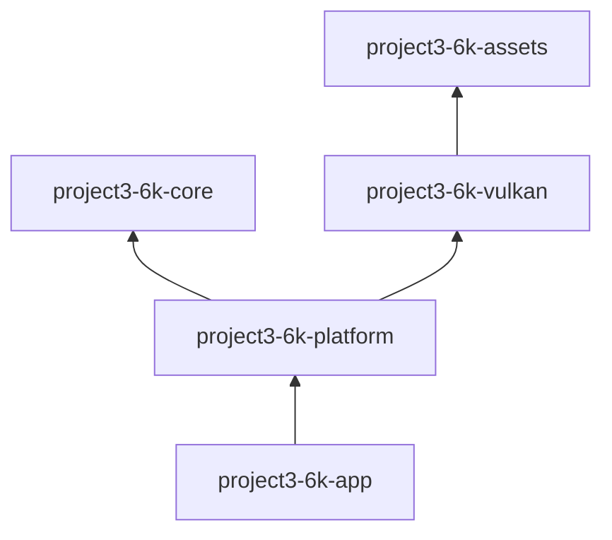

# Module dependencies

## Current crates

| Crate | Depends on | Public responsibility |
|---|---|---|
| `project3-6k-assets` | `base64`, `glam`, `gltf`, `image`, `png`, `thiserror` | Bounded raster decoding, static glTF/GLB CPU import, PBR material data, generational CPU model/texture caches, and bounded asynchronous model loading |
| `project3-6k-core` | `glam`, `thiserror` | `FrameClock`, rolling frame profiler, camera math, bounded scene nodes, and transforms |
| `project3-6k-vulkan` | `ash`, `ash-window`, `glam`, core, assets, `png`, `raw-window-handle`, `winit`, `thiserror`, `tracing` | `VulkanRenderer` initialization, bounded GPU model/material cache, device-local mesh and PBR texture uploads, FP16 HDR targets, ACES presentation pass, PBR reference scene, capture/readback, resize, and draw API |
| `project3-6k-platform` | core, Vulkan, `winit`, `thiserror`, `tracing` | `run()`, keyboard/mouse `InputState`, and window controls |
| `project3-6k-app` | platform, `tracing`, `tracing-subscriber` | executable entry point |

The platform crate coordinates core timing and Vulkan. Core does not know about windows, graphics, or application startup. Vulkan may consume CPU assets but the assets crate cannot import Vulkan or `ash`. This keeps file decoding separate from GPU resource management and prevents dependency cycles. `png` is used in Vulkan only for opt-in screenshot encoding; CPU image decoding remains in the assets crate.

## Crates intentionally deferred

There are no empty crates for scene, world, physics, audio, or debug UI. Assets has concrete CPU texture/model import and bounded cache responsibilities. GPU upload and resource lifetime stay in Vulkan. Other crates should be added when their first concrete public interface is ready.
