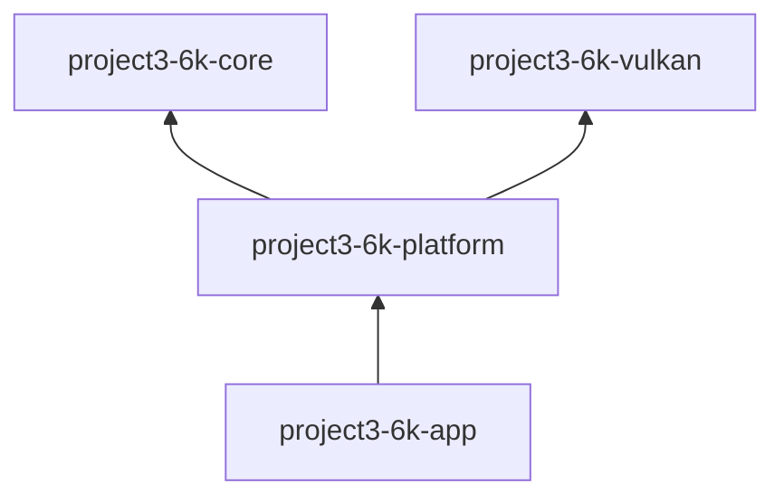

# Module dependencies

## Current crates

| Crate | Depends on | Public responsibility |
|---|---|---|
| `project3-6k-core` | `glam` | `FrameClock`, `FrameTime`, and first-person camera math |
| `project3-6k-vulkan` | `ash`, `ash-window`, `raw-window-handle`, `winit`, `thiserror`, `tracing` | `VulkanRenderer` initialization, resize, and draw API |
| `project3-6k-platform` | core, Vulkan, `winit`, `thiserror`, `tracing` | `run()`, keyboard/mouse `InputState`, and window controls |
| `project3-6k-app` | platform, `tracing`, `tracing-subscriber` | executable entry point |

The platform crate coordinates core timing and Vulkan. Core does not know about windows, graphics, or application startup. Vulkan does not depend on input or game state. This prevents a cycle between engine subsystems.

## Crates intentionally deferred

There are no empty crates for assets, scene, world, physics, audio, or debug UI. Each should be added when its first concrete responsibility and public interface are ready. This keeps the initial build small and avoids coupling future modules to premature abstractions.
