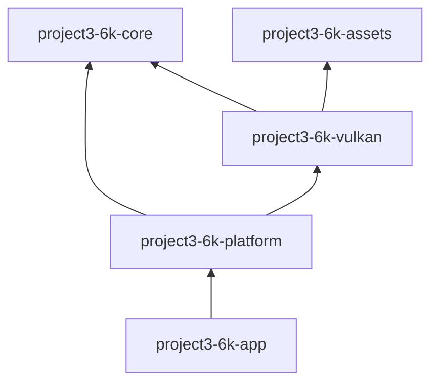

# Current module dependencies

This table reflects Cargo manifests at the Phase 0 audit commit. It is distinct from the proposed target graph in [Master Engine Architecture](master-architecture.md).

| Crate | Direct dependencies | Actual responsibility |
|---|---|---|
| `project3-6k-app` | `project3-6k-platform`, `tracing`, `tracing-subscriber` | Binary entry point, CLI parsing, logging setup |
| `project3-6k-platform` | core, Vulkan, `winit`, `thiserror`, `tracing` | Native application/event loop, input, camera, timing, and direct renderer composition |
| `project3-6k-core` | `glam`, `thiserror` | FrameClock, profiler, camera math, transform values, bounded Scene container |
| `project3-6k-assets` | `base64`, `glam`, `gltf`, `image`, `png`, `thiserror` | Bounded CPU image/model/environment import, material data, CPU caches, async model loader |
| `project3-6k-vulkan` | `ash`, `ash-window`, core, assets, `glam`, `half`, `png`, `raw-window-handle`, `thiserror`, `tracing`, `winit` | Vulkan context/swapchain/rendering, GPU asset cache, static reference scene, capture/readback |

The dependency graph has no cycle. `project3-6k-assets` cannot see Vulkan types. `project3-6k-platform` currently depends on Vulkan directly; Phase 2 should decide the lifecycle/renderer contract before moving this edge. `project3-6k-core::Scene` is not currently the input to `project3-6k-vulkan::ForestScene`.

Cargo tree evidence is captured in `docs/architecture/foundation-audit.md`. Future crates such as `engine`, `world`, and a backend-neutral render API are proposals only and must not be added as empty placeholders.
