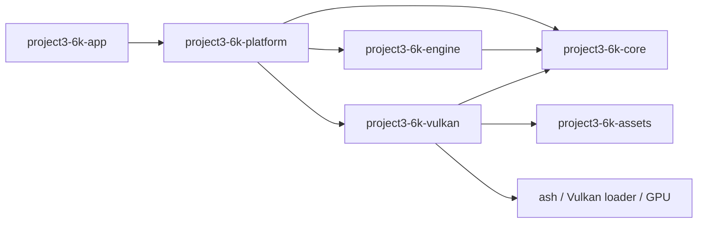

# Current architecture overview

This document describes the committed implementation, not the target architecture. The evidence-based audit is [Phase 0 — Foundation Audit](foundation-audit.md), the completed engine-core work is [Phase 2 — Engine Core](phase-2-engine-core.md), and the full phase-based target is [Master Engine Architecture](master-architecture.md).

## Current crate graph

The workspace contains six crates. The verified dependency graph is detailed in [module-dependencies.md](module-dependencies.md).

## Current ownership boundaries

- `project3-6k-app` owns argument parsing and tracing initialization.
- `project3-6k-platform` owns the `winit` event handler, native window, native-key mapping, camera controller, frame profiler, and `VulkanRenderer`. It hosts the engine and directly composes the current renderer.
- `project3-6k-engine` owns `EngineRuntime`, lifecycle state, a bounded platform-neutral event queue, logical action state, engine config/errors, and fixed/variable frame scheduling. It depends on core and contains no window or Vulkan types.
- `project3-6k-core` owns the reusable monotonic `FrameClock`/`FrameTime`, profiler/camera math, and a bounded `Scene` value container. That `Scene` is not wired to the live forest renderer.
- `project3-6k-assets` owns CPU decoding/import, typed CPU model/material/texture/environment data, the CPU model/PNG caches, and a bounded CPU model worker. It has no Vulkan dependency.
- `project3-6k-vulkan` owns the Vulkan context/device/surface, swapchain, frame synchronization, render targets/passes, static `ForestScene`, GPU model cache, sampled textures, and GPU resource lifetime.

The app drops the renderer before the window so the Vulkan surface is destroyed while the native window remains alive. The Vulkan renderer waits for device idle at swapchain teardown/recreation. Validation state remains alive through debug-messenger destruction.

## Current frame and asset flow

`winit` events are mapped to owned `EngineEvent`s; Engine updates its logical input state and dispatches queued events in order. Each redraw runs bounded fixed updates followed by one variable update (the current camera controller uses the variable delta), then Platform calls the renderer. The loop requests redraws at its configured interval. The renderer builds and draws its static forest reference scene into FP16 HDR, then tone maps to the swapchain. The CPU asset importer produces owned CPU data; model import uses a bounded worker, but startup drains all requested completions synchronously before GPU upload. GPU uploads and a real swapchain resize can block while the graphics queue/device is waited idle.

The current `ForestScene` owns its asset handles, placements, material descriptor sets, PBR pipelines, environment textures, and render-facing uniforms. It does not receive entities or a render snapshot from `core::Scene` or an ECS.

## Implemented and deferred

Implemented in the current renderer: external static glTF/GLB PBR assets, normal mapping, direct GGX PBR, SH diffuse IBL, GGX-prefiltered specular IBL with BRDF LUT, visible HDR environment, FP16 HDR, ACES tone mapping, a single 1024² directional shadow map, and optional PNG readback.

Not implemented: backend-neutral app/renderer composition, ECS/World, simulation systems using the fixed-step callback, scene streaming, terrain, culling/instancing/LOD, cascaded shadows, asynchronous GPU uploads, physics, animation/audio, or gameplay. See the master architecture for phased boundaries and gates.
