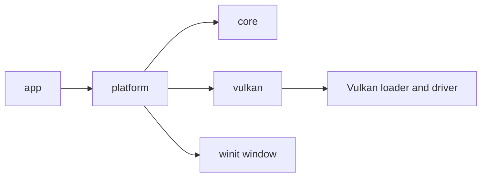

# Architecture overview

Project3.6k starts with the smallest set of modules that perform real work. It is a Cargo workspace, not a collection of placeholder crates.

## Ownership boundaries

The platform crate owns the native `Window`, `VulkanRenderer`, and first-person camera state. The Vulkan crate owns the instance, surface, device, swapchain, color/depth render pass, per-image depth attachments, graphics pipeline, static forest buffers, the sampled forest texture and sampler, per-frame camera uniform buffers and descriptor sets, framebuffers, command buffers, and synchronization primitives. `FrameClock` owns no system resources and allocates nothing per tick.

The application explicitly drops the renderer before the native window because the Vulkan surface is tied to the window handles. The renderer waits for device idle before destroying swapchain resources, then the Vulkan context destroys the device, debug messenger, surface, and instance in dependency-safe order. The validation callback's state outlives the debug messenger and is checked after renderer shutdown.

## Data flow

Native keyboard and raw mouse events update `InputState`; losing window focus clears held keys and releases cursor capture. The core `Camera` computes right-handed Vulkan view/projection matrices and bounded local movement without depending on the window or renderer. The platform layer sends its column-major matrix to Vulkan. Resize events mark the renderer suspended for zero-sized windows or request swapchain recreation for a valid size. The deterministic `--resize-stress` mode exercises these transitions, including minimize/restore.

The renderer owns the static indexed textured and lit forest draw, depth-tested submesh ordering, GPU synchronization, swapchain recreation, and submission. The bundled PNG is embedded in the Vulkan crate and decoded during scene initialization; authored vertex normals drive the ambient-plus-directional shader lighting. The platform layer owns event dispatch, frame pacing, camera input, and deterministic resize stress. Debug builds enable validation; any warning or error makes the application return a failure after resources are dropped. Neither layer depends on gameplay systems.

## Planned growth

When needed, general asset, scene, world, physics, and audio crates can be introduced with explicit interfaces. Core already owns the camera math; the current starter lighting uses authored normals and can move to mesh-derived normals as the forest gains spatial geometry. World streaming should use bounded budgets and asynchronous loading rather than retaining the complete world in memory.
