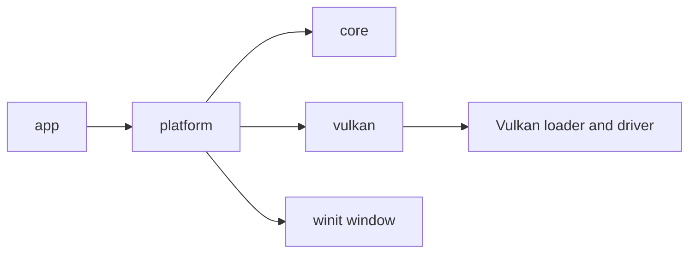

# Architecture overview

Project3.6k starts with the smallest set of modules that perform real work. It is a Cargo workspace, not a collection of placeholder crates.

## Ownership boundaries

The platform crate owns the native `Window` and `VulkanRenderer`. The Vulkan crate owns the instance, surface, device, swapchain, render pass, framebuffers, command buffers, and synchronization primitives. `FrameClock` owns no system resources and allocates nothing per tick.

The application explicitly drops the renderer before the native window because the Vulkan surface is tied to the window handles. The renderer waits for device idle before destroying swapchain resources, then the Vulkan context destroys the device, debug messenger, surface, and instance in dependency-safe order. The validation callback's state outlives the debug messenger and is checked after renderer shutdown.

## Data flow

Native key events update `InputState`; losing window focus clears held keys. The current foundation only uses Escape to close. Resize events mark the renderer suspended for zero-sized windows or request swapchain recreation for a valid size. The deterministic `--resize-stress` mode exercises these transitions, including minimize/restore.

The renderer owns GPU synchronization, swapchain recreation, and submission. The platform layer owns event dispatch, frame pacing, and deterministic resize stress. Debug builds enable validation; any warning or error makes the application return a failure after resources are dropped. Neither layer depends on gameplay systems.

## Planned growth

When needed, asset, math, scene, world, physics, and audio crates can be introduced with explicit interfaces. A rendering pipeline and resource allocator should be added before any advanced effects. World streaming should use bounded budgets and asynchronous loading rather than retaining the complete world in memory.
