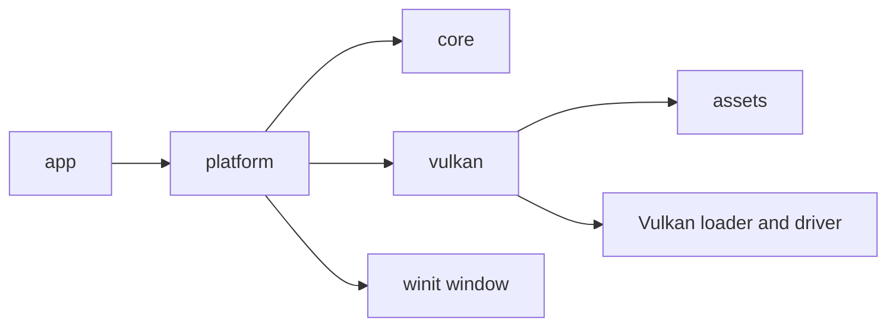

# Architecture overview

Project3.6k starts with the smallest set of modules that perform real work. It is a Cargo workspace, not a collection of placeholder crates.

## Ownership boundaries

The platform crate owns the native `Window`, `VulkanRenderer`, and first-person camera state. The core crate owns the platform-neutral frame profiler, camera math, scene nodes, mesh handles, and transforms. The assets crate loads bounded CPU texture data, imports static glTF/GLB meshes and metallic-roughness materials, caches imported CPU models, and offers a bounded background loading queue without depending on Vulkan. The Vulkan crate uploads data and owns GPU resource lifetime, the instance, surface, device, swapchain, color/depth attachments, PBR graphics pipeline, bounded GPU model cache, sampled images and samplers, per-frame scene uniform buffers and material descriptor sets, framebuffers, command buffers, and synchronization primitives.

The application explicitly drops the renderer before the native window because the Vulkan surface is tied to the window handles. The renderer waits for device idle before destroying swapchain resources, then the Vulkan context destroys the device, debug messenger, surface, and instance in dependency-safe order. The validation callback's state outlives the debug messenger and is checked after renderer shutdown.

## Data flow

Native keyboard and raw mouse events update `InputState`; losing window focus clears held keys and releases cursor capture. The core `Camera` computes right-handed Vulkan view/projection matrices and bounded local movement without depending on the window or renderer. The platform layer sends its column-major matrix to Vulkan. Resize events mark the renderer suspended for zero-sized windows or request swapchain recreation for a valid size. The deterministic `--resize-stress` mode exercises these transitions, including minimize/restore.

The renderer currently owns the static technical reference scene, depth-tested model/material draws, GPU synchronization, swapchain recreation, and submission. Ground and model data comes from licensed assets in the workspace and is loaded through the renderer-independent CPU importer; CPU objects do not contain Vulkan handles. The platform layer owns event dispatch, frame pacing, camera input, and deterministic resize stress. Debug builds enable validation; any warning or error makes the application return a failure after resources are dropped. Neither layer depends on gameplay systems.

## Planned growth

The assets crate provides bounded CPU decoding, model caching, and asynchronous import; Vulkan has a bounded GPU model/material cache and RAII resource ownership. The current scene uploads synchronously after asynchronous CPU import; runtime asset streaming remains future work. The renderer has directional GGX PBR and role-aware normal/material mipmaps, but not true FP16 HDR, a dedicated tone-mapping pass, shadow maps, or atmospheric fog yet. Keep the technical scene static until it needs dynamic transform upload. Future world streaming must retain bounded budgets and use the existing async loading boundary rather than retaining the complete world in memory.
