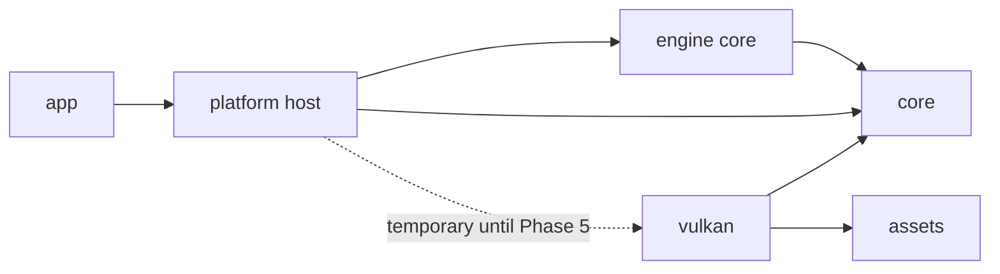

# Phase 1 — Architecture Review Before Phase 2

- **Review date:** 2026-11-12
- **Reviewed baseline:** `7350378` (documentation only; source remains the audited `d3b21b6` implementation)
- **Decision:** Pass with one documented boundary correction; Phase 2 may begin.

## Review results

| Requirement | Evidence and finding | Result |
|---|---|---|
| Master Architecture matches current code | The current implementation is still the five-crate graph in [module-dependencies.md](module-dependencies.md). `project3-6k-platform::EngineApplication` owns the `winit` loop, `Window`, `VulkanRenderer`, `InputState`, `Camera`, `FrameClock`, and `FrameProfiler`. The Master Architecture already calls that out as current behavior; its former target diagram incorrectly implied that Engine could own Platform and select a renderer before a renderer contract exists. The target has been corrected to distinguish the Phase 2 host adapter from Phase 5 backend selection. | Pass after correction |
| No circular dependencies | `cargo metadata --no-deps` and a workspace-member DFS show the current graph is acyclic: `app -> platform`; `platform -> core, vulkan`; `vulkan -> core, assets`; `core` and `assets` have no workspace-crate dependencies. The planned Phase 2 additions are `platform -> engine -> core`, with `platform -> vulkan` retained temporarily. This graph is acyclic by construction; it will be rechecked from Cargo metadata after implementation. | Pass |
| Ownership and threading are implementable | The OS event loop, window, camera, and Vulkan renderer remain owned on the existing main/event thread. Phase 2's `EngineRuntime` will be a value owned by `EngineApplication`; its bounded event queue, input state, lifecycle, and timing accumulator are accessed through `&mut self` on that same thread. No worker/job system or shared mutable state is introduced. The renderer is dropped before the window as it is today. | Pass |
| Phase 2 does not duplicate current systems | Reuse `core::FrameClock` and `FrameTime`; keep `FrameProfiler`; retain the app's `tracing_subscriber` setup; retain the platform `winit` loop, `RunOptions`, `ApplicationError` wrapping, `VulkanRenderer`, and renderer validation. Replace the platform's OS-key-specific `InputState` with an engine-owned logical-action state, while Platform only maps native keys to action IDs. Add only the missing engine lifecycle, bounded event dispatch, fixed/variable schedule, engine configuration, and engine-level typed errors. `core::Scene` remains untouched and unused until Phase 3. | Pass |

## Corrected Phase 2 boundary

The existing main loop is a `winit::ApplicationHandler` callback loop and renderer construction is currently in Platform. Moving that loop into an Engine crate now would require either an early render-backend abstraction or an inverted application framework not required by Phase 2. The accepted implementation keeps the platform event pump as host and makes the engine crate independent of Platform and Vulkan:

Platform translates native window/input events into owned engine events. Engine owns lifecycle state, a bounded queue, logical action state, and fixed/variable update scheduling. Platform calls those APIs on the event thread, performs the existing camera update, then calls the existing renderer. This gives Phase 2 a concrete end-to-end path without coupling Engine to `winit`/`ash` or creating a future rendering module early.

## Existing systems to preserve

| Existing implementation | Phase 2 action |
|---|---|
| `project3-6k-core::FrameClock` / `FrameTime` | Reuse as the monotonic source; add a fixed-step accumulator in Engine. |
| `project3-6k-core::FrameProfiler` | Keep in Platform and continue recording redraw/renderer timings. |
| `project3-6k-platform::EngineApplication` / `winit` loop | Keep as host; delegate lifecycle/event/tick state to `EngineRuntime`. |
| `project3-6k-platform::InputState` | Replace OS-specific key storage with engine logical actions; keep native key mapping/cursor capture in Platform. |
| app `tracing_subscriber` initialization | Reuse; add lifecycle logs via the existing `tracing` facade. |
| `RunOptions`, `ApplicationError`, `VulkanRenderer`, validation monitor | Keep in their current crates; Engine errors convert/contextualize without owning graphics resources. |
| `core::Scene` bounded prototype | Do not move or wrap it in Phase 2; reconcile in Phase 3. |

## Phase 2 implementation boundary

Expected files are limited to the new engine crate, the platform adapter/input integration, workspace manifests, and architecture/ownership/threading documentation. Rendering shaders, Vulkan resources, assets, camera math, `core::Scene`, terrain, ECS, and gameplay are out of scope.

Acceptance evidence will include deterministic tests for lifecycle transitions, event queue bounds/dispatch, action state/focus loss, fixed-step accumulation/catch-up cap, and variable delta clamping; the complete workspace test/lint/build set; Vulkan validation runtime tests for start/render/shutdown and resize/minimize/restore; and updated diagrams matching the resulting Cargo/source graph. The runtime tests prove orderly resource teardown behavior; they do not claim a process-wide memory-leak detector.
