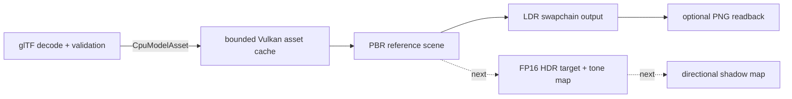

# Vulkan rendering and asset pipeline

## Current initialization

1. Dynamically load the Vulkan loader through `ash`, create the native surface, and select a graphics/present queue.
2. Create the swapchain, per-image depth attachments/framebuffers, and two frames in flight.
3. Start one bounded CPU glTF worker. It imports the four licensed static reference models while the renderer prepares GPU resources.
4. Upload model vertex/index buffers through host-visible staging into device-local allocations. Decode and resize limits remain in `project3-6k-assets`; this crate owns Vulkan images, samplers, buffers, cache entries, and destruction.
5. Upload external base-color, normal, metallic-roughness, and AO data. Color/emissive maps use sRGB images with linear-light mip reduction. Normal maps use linear UNORM images and vector-aware mip reduction. Metallic-roughness and AO use linear UNORM data and data-space mip reduction.
6. Load the Poly Haven forest-ground color, OpenGL normal, and ARM maps into a tiled technical ground plane. Build PBR descriptors, initialize per-frame scene uniforms, and record indexed draws for the external models.

The CPU importer accepts bounded local glTF 2.0 and GLB static triangle data, retains node transforms and PBR maps, and rejects unsupported deformation, line/point primitives, and external paths that escape the model directory. `AsyncModelLoader` bounds both queues. The current scene waits for its startup requests; asynchronous runtime loading and streaming are not implemented.

The Vulkan GPU cache allows up to 32 models and 256 MiB of estimated resident model buffers and texture mip data. Generational handles reject stale references. Upload staging allocations are temporary. Cache entries and their RAII resource wrappers are released after the renderer waits for device idle. The current unload API is explicitly named `unload_after_device_idle`; callers must honor that lifetime precondition. Swapchain resize destroys framebuffers and scene resources after an idle wait, then rebuilds them.

Imported materials currently support `TEXCOORD_0`, opaque and alpha-mask modes, base color, metallic, roughness, normal scale, AO strength, emissive, and double-sided normal handling. Alpha blend and alternate texture coordinate sets return typed errors instead of silently rendering incorrectly. The PBR fragment shader evaluates a GGX microfacet sun response and a restrained ambient term, applies normal mapping, and uses a temporary Reinhard display transform on the LDR swapchain.

## Rendering status and dependencies



Current renderer features: external glTF/GLB and raster import; role-correct PBR texture formats and mipmaps; device-local mesh uploads; GPU cache budget and RAII lifetime; directional sunlight; GGX PBR; alpha-masked foliage; depth testing; and PNG swapchain readback.

Not yet implemented: a floating-point HDR render target, dedicated tone-mapping pass, shadow maps/cascades, atmospheric fog, material blending, alternative UV sets, GPU asset streaming, and world/terrain streaming. The current in-shader display transform is not a claim of a full HDR pipeline.

## Frame submission and capture

The renderer has two frames in flight. It waits on the frame fence before updating that frame's scene uniform, acquires an image, waits for the prior image owner, records the scene, submits, and presents with image-indexed semaphores. When capture is requested and the surface supports `TRANSFER_SRC`, the captured swapchain image is copied to a bounded host-visible buffer, mapped after the fence, invalidated if non-coherent, converted from BGRA where needed, and encoded to PNG. Capture stalls one frame and is opt-in.

The pre-upgrade comparison is [baseline-before-rendering-upgrade.png](../../artifacts/visual-verification/baseline-before-rendering-upgrade.png). The PBR foundation output is [pbr-foundation-stage-3.png](../../artifacts/visual-verification/pbr-foundation-stage-3.png). The latter was opened and visually checked at 1280×720: imported models, tiled ground material, normal/material texture response, and direct lighting are visible. It has no cast shadows and remains a sparse technical scene; those are still open visual gaps.

For local verification, set `VULKAN_SDK` to a Vulkan SDK that includes `glslc`, then run:

```powershell
cargo test --workspace
cargo clippy --workspace --all-targets -- -D warnings
cargo run -p project3-6k-app -- --run-frames 5 --validation --capture-frame artifacts/visual-verification/current.png
```

The Vulkan run exercises the native application, external asset import, upload, rendering, validation callback, GPU readback, and shutdown. A successful compile alone does not verify rendered pixels. The optional screenshot command intentionally stalls the captured frame; do not use that frame for performance measurements.

## Next implementation steps

1. Render to a supported FP16 color-attachment image and add a fullscreen tone-mapping pass to the swapchain.
2. Add a depth-only directional shadow pass, beginning with one shadow map and measured bias/PCF tuning; consider cascades only after visual validation.
3. Compare screenshots and capture startup CPU import, GPU upload/resident bytes, and steady-state frame timing. Improve scene composition and evaluate a suitably sized licensed tree asset before broadening the reference scene.

See [Decision 0014](../decisions/0014-cpu-gltf-import.md) for CPU library selection and [Decision 0015](../decisions/0015-vulkan-pbr-foundation.md) for GPU upload, material, and lifetime choices.
