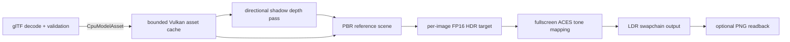

# Vulkan rendering and asset pipeline

## Current initialization

1. Dynamically load Vulkan through `ash`, create the native surface, and select a graphics/present queue.
2. Create the swapchain, per-image depth and FP16 HDR targets, and two frames in flight.
3. Start one bounded CPU glTF worker and import five licensed static reference models, including three internally instanced pine sapling variants. CPU parsing and image decoding stay in `project3-6k-assets`; Vulkan owns GPU upload and resource lifetime.
4. Upload model buffers and PBR maps through temporary staging allocations. Color/emissive textures use sRGB formats; normal, metallic-roughness, and AO maps use linear formats and role-correct mip reduction.
5. Upload the licensed forest-ground color, OpenGL normal, and ARM maps onto the tiled technical ground plane. Create material descriptors and per-frame scene uniforms.
6. Render a 1024×1024 directional shadow depth map for the current frame, then render GGX PBR into the per-image `R16G16B16A16_SFLOAT` target while sampling that shadow map.
7. Sample the HDR image in a fullscreen pass, apply fitted ACES tone mapping, and present to the swapchain.

The CPU importer accepts bounded local glTF 2.0 and GLB static triangle data, retains node transforms and PBR maps, and rejects unsupported deformation, line/point primitives, and external paths that escape the model directory. `AsyncModelLoader` bounds the CPU work queue, but the current startup waits for all five imports and uploads synchronously on the renderer thread. Runtime asset streaming is not implemented.

The Vulkan GPU cache allows up to 32 models and 256 MiB of estimated resident model buffers and texture mip data. Generational handles reject stale references. Upload staging allocations are temporary. Cache entries and RAII resources are released after device idle; callers of `unload_after_device_idle` must honor that lifetime precondition. A redundant same-size window event is ignored to avoid unnecessary scene reloads. A real extent change still recreates the current scene and can repeat its synchronous asset load; persistent GPU assets across resize remain future work.

Imported materials currently support `TEXCOORD_0`, opaque and alpha-mask modes, base color, metallic, roughness, normal scale, AO strength, emissive, and double-sided normal handling. Alpha blend and alternate texture coordinate sets return typed errors instead of silently rendering incorrectly. The PBR fragment shader evaluates a GGX sun response, four-tap comparison-filtered shadows, a restrained ambient term, normal mapping, and distance fog. It writes linear radiance to FP16 HDR; a separate pass applies ACES tone mapping before presentation.

## Rendering dependency graph



Implemented: external glTF/GLB and raster import; role-correct PBR texture formats and mipmaps; device-local mesh uploads; bounded GPU cache and RAII lifetime; directional sunlight; GGX PBR; alpha-masked foliage; 1024² single-map directional shadows with four comparison taps; distance fog; FP16 HDR; ACES tone mapping; and opt-in PNG swapchain readback.

Still open: cascaded shadows, environment image-based lighting, full terrain/forest generation, LOD and frustum culling, instanced vegetation, material blending, alternate UV sets, asynchronous GPU uploads, and world/asset streaming. The current shadow map covers one scene-sized area and is not a cascaded production solution. Ambient light is a restrained approximation without environment lighting.

## Visual verification and performance

The baseline is [baseline-before-rendering-upgrade.png](../../artifacts/visual-verification/baseline-before-rendering-upgrade.png). The PBR stage is [pbr-foundation-stage-3.png](../../artifacts/visual-verification/pbr-foundation-stage-3.png), HDR/tone mapping is [hdr-stage-1.png](../../artifacts/visual-verification/hdr-stage-1.png), shadow stage is [release-shadow-reference.png](../../artifacts/visual-verification/release-shadow-reference.png), and the expanded pine reference scene is [forest-pine-stage-2.png](../../artifacts/visual-verification/forest-pine-stage-2.png). The 1280×720 Release captures were opened and inspected; the expanded scene adds three external pine saplings, real ground/model textures, and cast shadows. Those pines appear dark without environment lighting, and the scene remains sparse with a flat ground plane and visible shadow aliasing; no claim of finished game-level realism is made.

Measured on an NVIDIA GeForce GTX 1660 SUPER at 1280×720 using the Windows Release build, without capture, over 600 submitted frames with one pine group: rolling batches reported 73.1–78.1 FPS, 12.8–13.7 ms average frame interval, p95 15.2–16.5 ms, and maximum 15.9–30.6 ms. App startup to the rendered-ready scene was about 1.63 seconds: CPU model import about 0.30 seconds, model GPU uploads about 0.94 seconds, and ground/renderer setup about 0.20 seconds. Resident model buffers and model texture mips were reported as 138,377,796 bytes; ground GPU resources were 16,777,212 bytes. A three-group pine layout raised p95 to about 34–36 ms and was not retained. The cold first Release build took 86.1 seconds; warm incremental Release rebuilds took 5.1–6.5 seconds and the warm incremental dev build took 2.85 seconds. These are one-machine measurements, not cross-GPU guarantees. Screenshot capture deliberately stalls a frame and must not be used for performance timing.

## Local verification

Set `VULKAN_SDK` to an SDK that provides `glslc`, then run from the repository root:

```powershell
cargo test --workspace
cargo clippy --workspace --all-targets -- -D warnings
cargo run -p project3-6k-app -- --run-frames 5 --validation --capture-frame artifacts/visual-verification/current.png
```

The Vulkan run opens the native application, loads external assets, renders, captures a real swapchain frame, checks validation, and exits. Compilation alone does not verify pixels. To inspect runtime profiling, use `$env:RUST_LOG='debug'; cargo run -p project3-6k-app -- --run-frames 600` and read the rolling profiler lines or window title after startup.

The current Release test executable is `target/release/project3-6k.exe`. Run it from this checkout so its external reference assets remain available. For interactive testing in PowerShell:

```powershell
.\target\release\project3-6k.exe
```

Click the window to capture the mouse, move with WASD, use Space/Shift to rise or descend, press Escape once to release the mouse, and press Escape again to close. This build loads the technical scene; it does not contain gameplay or a survival loop.

See [Decision 0014](../decisions/0014-cpu-gltf-import.md) for the CPU import library choice, [Decision 0015](../decisions/0015-vulkan-pbr-foundation.md) for the GPU cache/material foundation, [Decision 0016](../decisions/0016-fp16-hdr-tone-mapping.md) for HDR and tone mapping, [Decision 0017](../decisions/0017-directional-shadow-and-resize-startup.md) for the shadow pass and startup resize fix, and [Decision 0018](../decisions/0018-pine-sapling-reference-asset.md) for the licensed pine reference asset.
