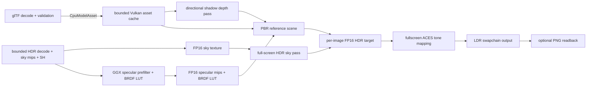

# Vulkan rendering and asset pipeline

## Current initialization

1. Dynamically load Vulkan through `ash`, create the native surface, and select a graphics/present queue.
2. Create the swapchain, per-image depth and FP16 HDR targets, and two frames in flight.
3. Start one bounded CPU glTF worker and import five licensed static reference models, including three internally instanced pine sapling variants. CPU parsing and image decoding stay in `project3-6k-assets`; Vulkan owns GPU upload and resource lifetime.
4. Decode the licensed 2K Radiance HDR environment on the CPU, generate the sky mip chain, integrate diffuse irradiance into nine real spherical-harmonic coefficients, GGX-prefilter the specular radiance, and integrate a split-sum BRDF LUT. Upload the sky, prefiltered specular mips, and LUT as FP16 sampled textures owned by `ForestScene`.
5. Upload model buffers and PBR maps through temporary staging allocations. Color/emissive textures use sRGB formats; normal, metallic-roughness, and AO maps use linear formats and role-correct mip reduction.
6. Upload the licensed forest-ground color, OpenGL normal, and ARM maps onto the tiled technical ground plane. Create material descriptors and per-frame scene uniforms, including compact diffuse irradiance coefficients.
7. Render a 1024×1024 directional shadow depth map for the current frame. In the HDR scene pass, draw the visible environment from a full-screen triangle and the camera inverse view-projection, then render GGX PBR geometry with SH diffuse IBL, prefiltered specular IBL, the BRDF LUT, and directional shadows.
8. Sample the scene HDR image in a fullscreen pass, apply fitted ACES tone mapping, and present to the swapchain.

The CPU importer accepts bounded local glTF 2.0 and GLB static triangle data, retains node transforms and PBR maps, and rejects unsupported deformation, line/point primitives, and external paths that escape the model directory. `AsyncModelLoader` bounds the CPU work queue, but the current startup waits for all five imports and uploads synchronously on the renderer thread. Runtime asset streaming is not implemented.

The Vulkan GPU cache allows up to 32 models and 256 MiB of estimated resident model buffers and texture mip data. Generational handles reject stale references. Upload staging allocations are temporary. Cache entries and RAII resources are released after device idle; callers of `unload_after_device_idle` must honor that lifetime precondition. A redundant same-size window event is ignored to avoid unnecessary scene reloads. A real extent change still recreates the current scene and can repeat its synchronous asset load; persistent GPU assets across resize remain future work.

Imported materials currently support `TEXCOORD_0`, opaque and alpha-mask modes, base color, metallic, roughness, normal scale, AO strength, emissive, and double-sided normal handling. Alpha blend and alternate texture coordinate sets return typed errors instead of silently rendering incorrectly. The PBR fragment shader evaluates a GGX sun response, nine-coefficient diffuse environment irradiance, roughness-selected environment mip reflections, four-tap comparison-filtered shadows, normal mapping, and distance fog. Alpha-masked materials get a restrained opposite-side diffuse contribution to approximate foliage transmission. It writes linear radiance to FP16 HDR; a separate pass applies ACES tone mapping before presentation.

The environment importer is separate from Vulkan and enforces configured image dimensions, external-file size, and total CPU-memory limits. CPU data is converted to FP16 only in the Vulkan upload layer. `ForestScene` owns the sky, prefiltered specular, and BRDF LUT textures; the general model cache remains independently budgeted. Model decoding already runs on the bounded CPU worker, while this single reference HDRI is imported and uploaded synchronously during startup. On the measured machine, decoding, GGX prefiltering, LUT integration, and upload took about 283 ms and retained 45.7 MB of CPU environment data. The visible sky pass reconstructs a world-space direction from the camera inverse view-projection and samples the source environment without adding sky geometry. General-purpose environment streaming and asynchronous GPU uploads remain unimplemented.

Diffuse irradiance uses a second-order spherical-harmonic approximation integrated over the equirectangular HDRI. Specular radiance uses a CPU-generated GGX importance-sampled mip chain and the shader combines it with a 128×128 split-sum BRDF integration LUT. The prefilter uses bounded Hammersley samples and samples the source HDR mip chain according to the GGX sample footprint. This is a standard real-time PBR approximation, not a path-traced reflection solution.

## Rendering dependency graph



Implemented: external glTF/GLB and raster import; bounded Radiance HDR import; FP16 sky, GGX-prefiltered specular mip, and BRDF LUT uploads; CPU diffuse irradiance SH; visible HDR sky background; role-correct PBR texture formats and mipmaps; device-local mesh uploads; bounded GPU model cache and RAII lifetime; directional sunlight; direct GGX PBR and split-sum specular IBL; alpha-masked foliage with approximate back-side diffuse; 1024² single-map directional shadows with four comparison taps; distance fog; FP16 HDR; ACES tone mapping; and opt-in PNG swapchain readback.

Still open: cascaded shadows, full terrain/forest generation, LOD and frustum culling, instanced vegetation, material blending, alternate UV sets, asynchronous GPU uploads, and world/asset streaming. The current shadow map covers one scene-sized area and is not a cascaded production solution. The reference layout is sparse and does not yet represent a finished forest.

## Visual verification and performance

The baseline is [baseline-before-rendering-upgrade.png](../../artifacts/visual-verification/baseline-before-rendering-upgrade.png). The PBR stage is [pbr-foundation-stage-3.png](../../artifacts/visual-verification/pbr-foundation-stage-3.png), HDR/tone mapping is [hdr-stage-1.png](../../artifacts/visual-verification/hdr-stage-1.png), shadow stage is [release-shadow-reference.png](../../artifacts/visual-verification/release-shadow-reference.png), previous pine scene is [forest-pine-stage-2.png](../../artifacts/visual-verification/forest-pine-stage-2.png), IBL-only scene is [forest-pine-ibl-final.png](../../artifacts/visual-verification/forest-pine-ibl-final.png), 1K sky is [forest-pine-skybox-final.png](../../artifacts/visual-verification/forest-pine-skybox-final.png), 2K sky is [forest-pine-skybox-2k-final.png](../../artifacts/visual-verification/forest-pine-skybox-2k-final.png), and the current GGX/BRDF capture is [forest-pine-ggx-brdf-final.png](../../artifacts/visual-verification/forest-pine-ggx-brdf-final.png). The 1280×720 Release captures were opened and inspected. The PBR capture verifies the loaded material textures, visible environment, and directional shadows; the scene layout remains essentially unchanged, and the ground is still a flat plane with a hard horizon. This remains a renderer foundation rather than a finished forest.

On an NVIDIA GeForce GTX 1660 SUPER at 1280×720, the current Release validation run rendered 600 frames in 7.97 seconds after the app became ready (about 75.3 frames/s, at the window's 75 Hz cap). The ready message arrived about 1.67 seconds after native window creation. Model CPU import took 0.23 seconds, model GPU upload 0.69 seconds, and environment import/prefilter/upload 0.28 seconds. The environment uses 45,700,448 retained CPU bytes and 22,850,224 GPU bytes; model buffers and textures use 138,377,796 GPU bytes; ground resources use 16,777,212 GPU bytes. Vulkan validation reported zero warnings and zero errors in both the 600-frame run and 5-frame capture run. Prior non-validation measurements on this machine reported 74.8–77.3 FPS; these are interactive desktop figures, not isolated GPU benchmarks or cross-GPU guarantees. Screenshot capture deliberately stalls a frame and must not be used for performance timing.

## Local verification

Set `VULKAN_SDK` to an SDK that provides `glslc`, then run from the repository root:

```powershell
cargo test --workspace
cargo clippy --workspace --all-targets -- -D warnings
cargo run -p project3-6k-app -- --run-frames 5 --validation --capture-frame artifacts/visual-verification/current.png
```

The Vulkan run opens the native application, loads external assets, renders, captures a real swapchain frame, checks validation, and exits. Compilation alone does not verify pixels. To inspect runtime profiling, use `$env:RUST_LOG='debug'; cargo run -p project3-6k-app -- --run-frames 600` and read the rolling profiler lines or window title after startup.

The current Release test executable is `target/release/project3-6k.exe`. Run it from this checkout so its external reference assets remain available. For interactive testing in PowerShell:

```powershell
.\target\release\project3-6k.exe
```

Click the window to capture the mouse, move with WASD, use Space/Shift to rise or descend, press Escape once to release the mouse, and press Escape again to close. This build loads the technical scene; it does not contain gameplay or a survival loop.

See [Decision 0014](../decisions/0014-cpu-gltf-import.md) for the CPU import library choice, [Decision 0015](../decisions/0015-vulkan-pbr-foundation.md) for the GPU cache/material foundation, [Decision 0016](../decisions/0016-fp16-hdr-tone-mapping.md) for HDR and tone mapping, [Decision 0017](../decisions/0017-directional-shadow-and-resize-startup.md) for the shadow pass and startup resize fix, [Decision 0018](../decisions/0018-pine-sapling-reference-asset.md) for the licensed pine reference asset, [Decision 0019](../decisions/0019-hdr-environment-ibl.md) for environment lighting, [Decision 0020](../decisions/0020-hdr-sky-background.md) for visible environment rendering, [Decision 0021](../decisions/0021-hdr-environment-resolution.md) for the 2K environment asset, and [Decision 0022](../decisions/0022-ggx-specular-ibl.md) for GGX-prefiltered specular IBL.
