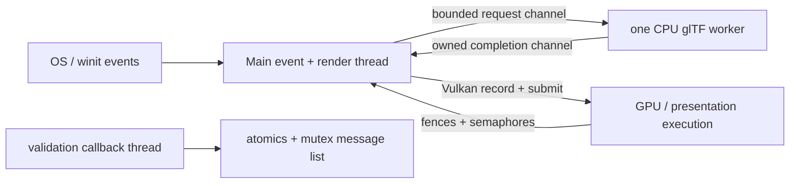

# Current and target thread model

This file records threads that exist in the audited source and the constraints for future phases. The target schedule is defined in [Master Engine Architecture](../architecture/master-architecture.md).

## Current implementation

- `winit` invokes `EngineApplication` on one event-loop thread. Window/input handling, camera update, clock/profiling, command recording, and submission currently run there.
- `about_to_wait` requests redraw and sets a wait-until frame deadline. The loop is variable-delta; camera movement caps large deltas. There is no fixed-timestep simulation or internal event bus.
- `AsyncModelLoader` starts one named CPU worker with bounded request and completion queues. It performs file read/import/validation only. Current startup waits for every requested completion, then the main thread uploads the assets.
- Environment HDR decode, GGX filtering, BRDF LUT generation, texture upload, and render-scene creation run synchronously during renderer initialization.
- GPU execution and presentation are asynchronous relative to CPU submission and are ordered with frame fences/semaphores. The app waits for the matching fence before updating frame-owned uniform data.
- Vulkan validation callbacks can arrive from an implementation-selected thread. They update atomic counts and retain owned warning/error messages behind a mutex; the application reads the report after renderer teardown.

## Target constraints

- Keep window and input mutation on the main/event thread.
- Keep World writes and initial Vulkan object creation on a single owner thread until profiling justifies another schedule.
- Cross-thread messages carry owned request IDs, generations, CPU payloads, or typed errors; no worker holds a borrow into World or renderer state.
- Bound both request and completion queues so uncollected assets apply back-pressure instead of growing memory without limit.
- Stale/cancelled requests are rejected by generation/request ID before they become resident.
- A future upload worker may prepare CPU staging data, but Vulkan object creation/submission stays on the backend owner unless explicit device/queue synchronization is designed.
- Do not add a generic job system in Phase 2. Phase 4 can expand the bounded loader; Phase 6 can add region jobs when chunk ownership/cancellation is specified.

## Current shutdown

The loader is dropped after startup completions are drained and joins its worker. `EngineApplication::drop` releases cursor capture, takes/drops the renderer, then drops the window. The renderer waits for device idle before destroying swapchain-owned resources. The validation report is checked after application/renderer shutdown in validation mode.

These rules are correct for the current static startup renderer but do not yet provide cancellation, streaming priorities, fixed simulation scheduling, or fence-based per-asset retirement.
